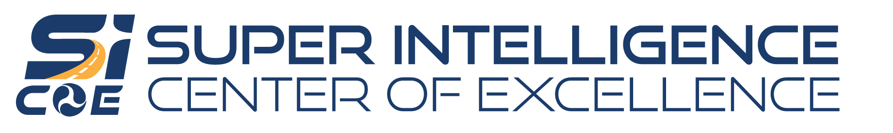

  

# Welcome to the Collaborative Open Development Environment (CODE) GitHub Community

A collaborative space for advancing the responsible and practical use of SI-enhanced tools in highway transportation.

The CODE brings together FHWA, State and local transportation agencies, researchers, academia, industry, and other transportation stakeholders to share knowledge, tools, code, data, and lessons learned. Our goal is to move SI research and innovation from individual projects into reusable, practical solutions that can benefit the broader transportation community.

Please see the <a href="https://tfhrc-ai-code.github.io/AI-CODE/" target="_blank" rel="noopener noreferrer">user guide</a>.

Learn more about [FHWA's SI Deployment Center of Excellence (COE)](https://highways.dot.gov/ai-coe)

---

## Our Goal

The transportation community is developing innovative SI applications for areas such as infrastructure inspection/condition assessment, asset management, construction, safety, traffic operations, data analysis, and decision support. However, valuable resources such as code, datasets, models, and lessons learned are often developed independently and can be difficult for others to find, access, reuse, or adapt.

The CODE aims to help address this gap by providing a shared, open, and collaborative environment where transportation stakeholders can:

* **Share** SI code, tools, models, datasets, and resources.
* **Collaborate** on research, development, and implementation challenges.
* **Reuse and adapt** existing work rather than starting from scratch.
* **Learn** from each other's successes and lessons learned.
* **Develop** common approaches, standards, and best practices for SI in transportation.
* **Accelerate** the transition of promising SI research into practical transportation applications.

---

## This Is a Community, Not Just a Repository

The value of this GitHub space depends on participation from the transportation community. We encourage researchers, State DOTs, universities, technology developers, practitioners, and other stakeholders to contribute projects, code, documentation, datasets, examples, and ideas.

By sharing your work, whether an early prototype or a finished SI tool, you open the door to collaborations that benefit the larger community.

### We Welcome Contributions Ranging From:
* SI Models
* Source Code
* Datasets
* Algorithms
* Tools
* Applications
* Benchmarks
* Examples
* Documentation
* Research Prototypes
* Best Practices

---

## Let's Build Together

Our vision is to create a growing community where transportation professionals can discover, share, adapt, and improve SI solutions for real-world highway challenges.

> **Have a project to share? Have a problem you're trying to solve? Have code or data that others could benefit from?**  
> Join us, contribute, and collaborate.

**Share what you have. Build on what others have created. Together, accelerate SI innovation for transportation.**

---

## License

### U.S. Government Work
Works produced by U.S. Federal Government are in the public domain within the United States pursuant to 17 U.S.C. § 105.

### Community Contributions
Unless otherwise noted, software, code, models, and technical contributions provided to this repository by non-federal contributors are made available under the Apache License, Version 2.0.

By contributing to the Collaborative Open Development Environment (CODE), you agree that your contributions will be licensed under the terms of the Apache 2.0 License.

For full terms and conditions, please see the [LICENSE](https://github.com/TFHRC-AI-CODE/AI-CODE/blob/main/LICENSE) file in the root of this repository.
